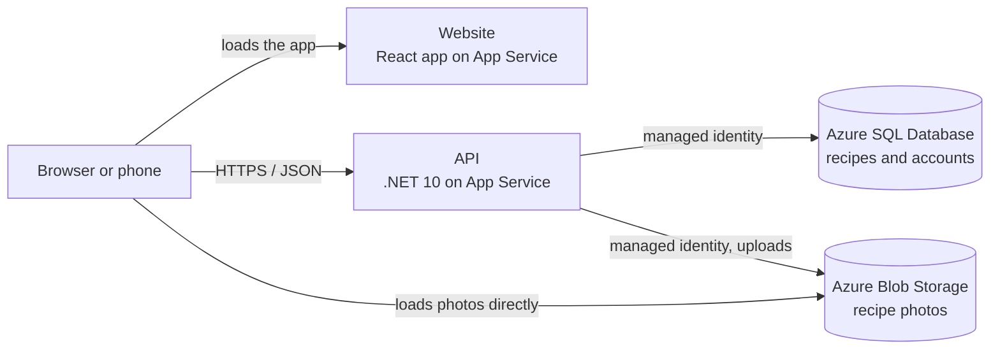

# Simple Cooking

A mobile-first recipe sharing web app. Browse recipes without an account, and sign in with a passkey or password to share your own.

**Live site:** https://simplecooking.azurewebsites.net

> The source code lives in private repositories (a React front end and a .NET API). It's available on request.

## Features

- **Browse freely.** Anyone can read recipes; an account is only needed to add them, and only a recipe's author can edit or delete it.
- **Filters.** Narrow the list by skill level, cuisine and total time (30 min or less, 30 min to 1 hr, over 1 hr). Filters live in the URL, so they survive refreshes and can be shared.
- **Favourites.** Tap the heart on any recipe to save it, then switch on the Favourites filter to see just those. Favourites are private to each account.
- **Friendly cold starts.** The free-tier servers sleep when idle; the app tells visitors it's waking up instead of looking stuck, retries automatically, and keeps a copy of itself in the browser so return visits open quickly.
- **Recipe pages built for cooking.** Swipe between Overview, Ingredients and Cooking pages, tick off ingredients as you go, and keep the screen awake while you cook.
- **Photos with cropping.** Upload a photo and frame it in a 4:3 crop before saving. Photos are resized in the browser first, which also strips metadata such as GPS location. Recipes without a photo get a patterned placeholder.
- **Author aliases.** Recipes show a public alias chosen on the account page, never an email address.
- **Passkey sign-in.** Create an account and sign in with Face ID, a fingerprint or a device PIN, no password needed. Passwords are supported too.
- **Phone-first design.** Bottom tab bar, large touch targets, a sticky save bar, and full light and dark themes.

## Tech stack

| Part | Technology |
| --- | --- |
| Web app | React 19, TypeScript, Vite, React Router |
| API | ASP.NET Core minimal API on .NET 10, Entity Framework Core |
| Accounts | ASP.NET Core Identity with bearer tokens and passkeys (WebAuthn) |
| Database | Azure SQL Database |
| Photos | Azure Blob Storage |
| Hosting | Azure App Service (Linux) for both the website and the API |

## Architecture

The website and API are separate apps, so they're deployed and versioned independently. Browsers load photos straight from storage, which keeps that traffic off the API and database.

## Security highlights

- **No stored secrets.** The API reaches the database and photo storage with its Azure managed identity. The database accepts only Microsoft Entra sign-ins, and storage has key-based access turned off.
- **Passkeys are bound to the site**, so they can't be phished, and the server keeps only their public keys. Passwords are stored as salted hashes.
- **Ownership is enforced by the API**, not just the interface: only a recipe's author can change or delete it or its photo.
- **Uploads are checked server-side**: real JPEG, PNG or WebP content only, at most 5 MB.
- **Sign-in and uploads are rate-limited**, and all traffic is HTTPS only.
